# Lab 03 – REST API, Query Parameters, Validation and Debugging

**Name:** Avuluri Venkata Ramana

**Registration Number:** 252U1R1018

**Section:** CSE-2A

---

## 1. Project Overview

This project demonstrates the development of a REST API using Node.js, Express.js and SQLite.

It provides CRUD operations for managing books, along with searching, sorting, pagination, price filtering, input validation and error handling.

## 2. Technologies Used

- Node.js
- Express.js
- SQLite3
- JavaScript
- Postman
- Visual Studio Code
- Git and GitHub

## 3. Project Structure

```text
Lab3-BFD/
│
├── server.js
├── database.js
├── database.db
├── package.json
├── package-lock.json
├── README.md
├── .gitignore
│
└── screenshots/
    ├── POST_Create_Book.png
    ├── GET_All_Books.png
    ├── GET_Search_Books.png
    ├── GET_Sorting.png
    ├── GET_Pagination.png
    ├── GET_Price_Filter.png
    ├── POST_Validation_Error.png
    ├── PUT_Update_Book.png
    ├── DELETE_Book.png
    ├── DELETE_Not_Found.png
    ├── Invalid_Min_Price.png
    ├── Invalid_Max_Price.png
    └── Invalid_Price_Range.png
```

## 4. GitHub Repository

**GitHub Repository:** [https://github.com/avulurivenkataramana-gif/Lab3-BFD-Avuluri-Venkata-Ramana](YOUR_GITHUB_URL)

## 5. Live Deployment

**Live Application:** [Open Live Application](YOUR_DEPLOYMENT_URL)

> Replace the placeholder links with your actual URLs after creating the GitHub repository and deploying the application. If you have not deployed it, remove this section temporarily.

## 6. Installation and Setup

Clone the repository:

```bash
git clone YOUR_GITHUB_URL
```

Move into the project directory:

```bash
cd Lab3-BFD
```

Install dependencies:

```bash
npm install
```

## 7. Run the Application

Start the server:

```bash
npm start
```

Development mode:

```bash
npm run dev
```

**Local Server URL:**

`http://localhost:3000`

## 8. API Endpoints

| HTTP Method | Endpoint | Description |
|---|---|---|
| GET | `/books` | Retrieve all books |
| POST | `/books` | Add a new book |
| PUT | `/books/:id` | Update an existing book |
| DELETE | `/books/:id` | Delete a book |

## 9. Query Parameters

| Parameter | Description |
|---|---|
| `search_q` | Search books by title |
| `order_by` | Sort records by a column |
| `order` | Sort in ASC or DESC order |
| `limit` | Set the number of records |
| `offset` | Set the starting position |
| `min_price` | Filter by minimum price |
| `max_price` | Filter by maximum price |

### Example Requests

**Search:**

```text
GET /books?search_q=Harry
```

**Sorting:**

```text
GET /books?order_by=price&order=DESC
```

**Pagination:**

```text
GET /books?limit=5&offset=0
```

**Price Filtering:**

```text
GET /books?min_price=100&max_price=500
```

## 10. Input Validation and Error Handling

- Title and author are required.
- Price must be a valid non-negative number.
- Invalid input returns HTTP 400.
- A book that does not exist returns HTTP 404.
- Minimum price cannot be greater than maximum price.
- Error responses use a consistent JSON message format.

## 11. HTTP Status Codes

| Status Code | Description |
|---|---|
| 200 | Successful request |
| 201 | Resource created successfully |
| 400 | Bad request |
| 404 | Resource not found |
| 500 | Internal server error |

## 12. Debugging Concepts

The following common debugging issues were studied:

1. **EADDRINUSE:** Port is already in use.
2. **Wrong Import Path:** Incorrect database file path.
3. **No Such Table:** Incorrect SQLite table name.
4. **Missing Await:** Asynchronous database operations must be awaited.

## 13. Postman Testing

The REST API was tested using Postman.

Test cases include:

- Creating a book
- Retrieving all books
- Searching books
- Sorting books
- Pagination
- Price filtering
- Invalid input validation
- Updating a book
- Deleting a book
- Handling non-existing book IDs
- Invalid minimum and maximum price values

## 14. Postman Screenshots

### 1. Create Book

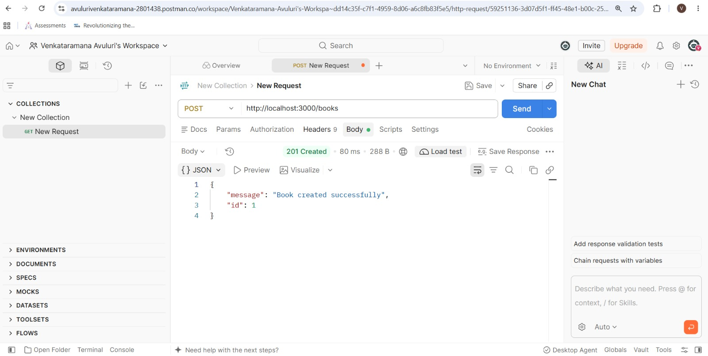

### 2. Get All Books

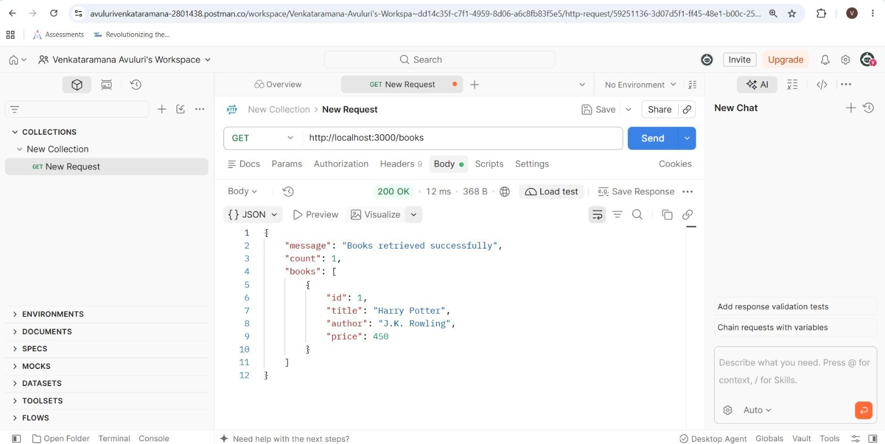

### 3. Search Books

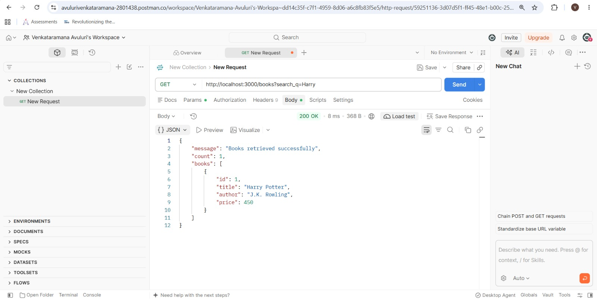

### 4. Sorting

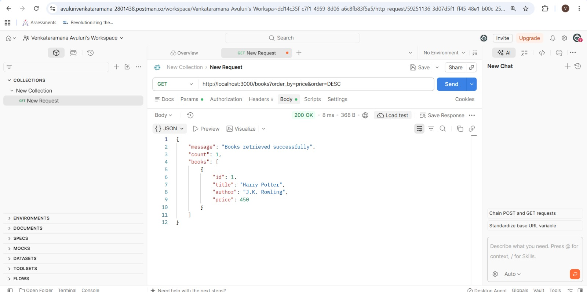

### 5. Pagination

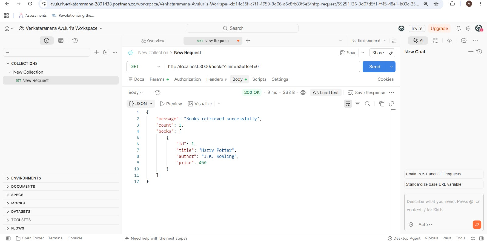

### 6. Price Filter

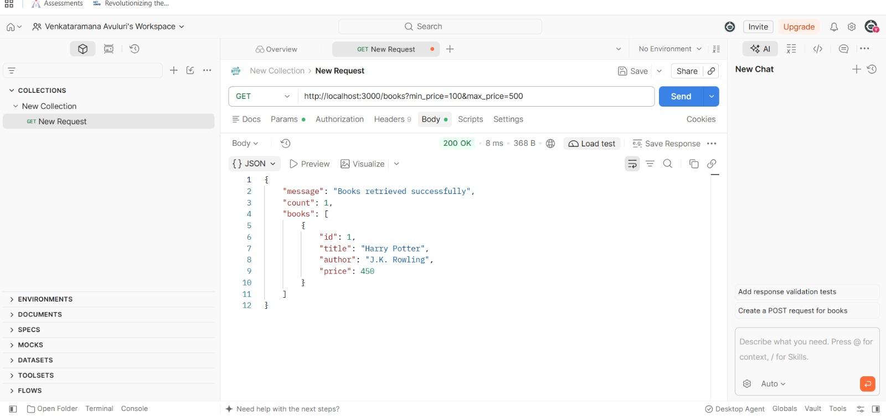

### 7. POST Validation Error

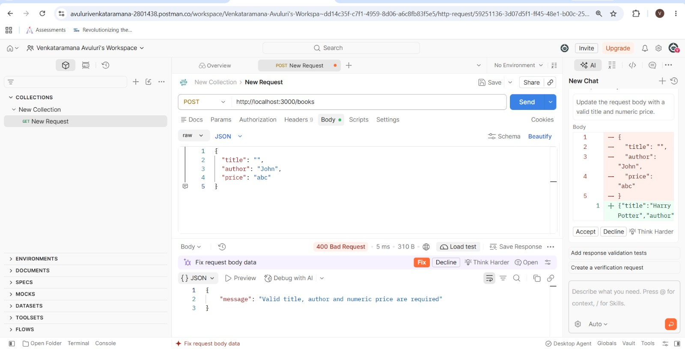

### 8. Update Book

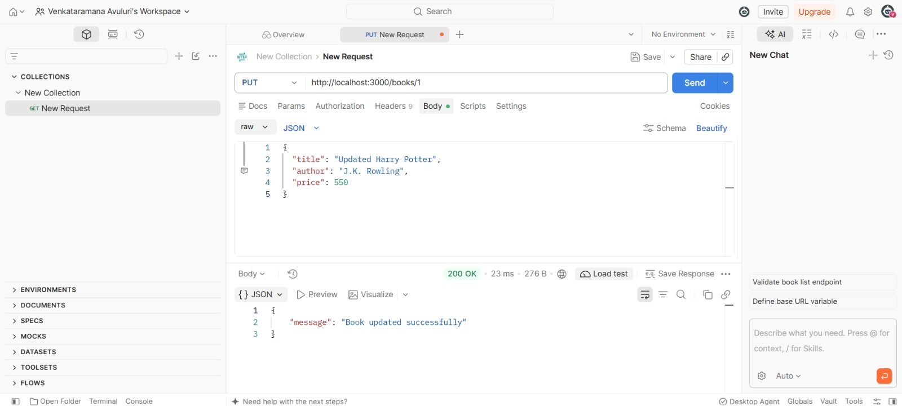

### 9. Delete Book

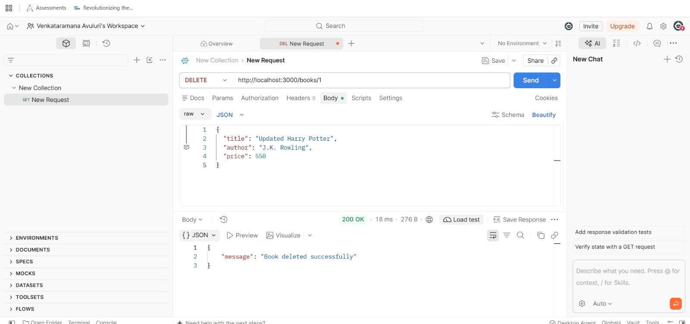

### 10. Delete Non-existing Book

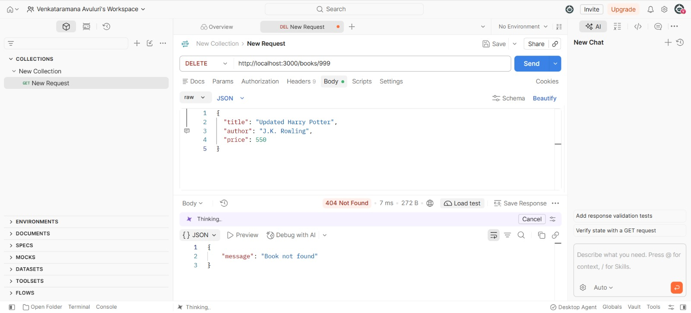

### 11. Invalid Minimum Price

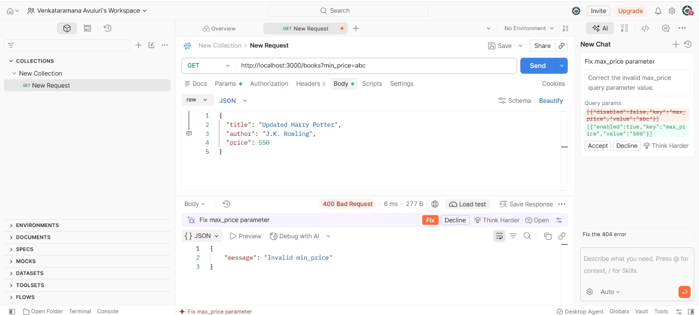

### 12. Invalid Maximum Price

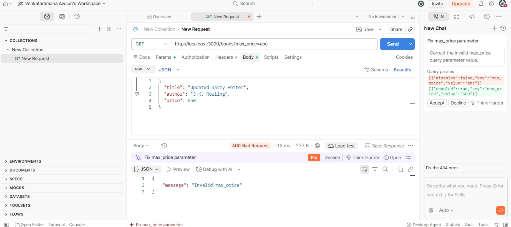

### 13. Invalid Price Range

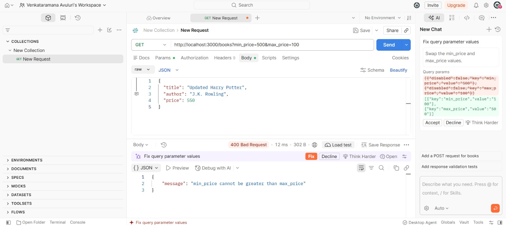

## 15. Conclusion

Successfully developed and tested a REST API using Node.js, Express.js and SQLite. The project implements CRUD operations, query parameters, searching, sorting, pagination, price filtering, input validation and error handling. Postman was used to test the API with both successful and invalid requests.